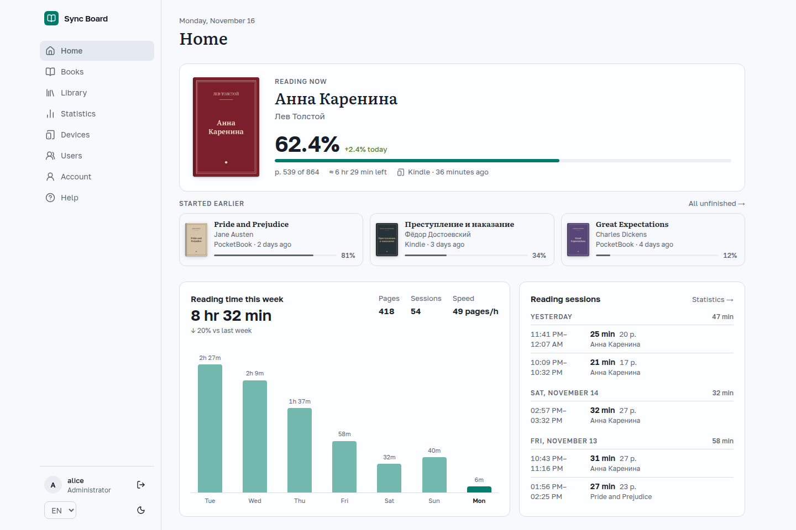

# koreader-sync-board

[](https://github.com/varrcan/koreader-sync-board/actions/workflows/ci.yml)
[](https://github.com/varrcan/koreader-sync-board/releases/latest)
[](https://github.com/varrcan/koreader-sync-board/pkgs/container/koreader-sync-board)
[](server/go.mod)
[](LICENSE)

English | [Русский](README_ru.md)

A lightweight self-hosted server for the **standard** KOReader: progress sync, reading
statistics and a web panel, with nothing to install on the e-reader.

<picture>
  <source media="(prefers-color-scheme: dark)" srcset="docs/images/panel-en-dark.png">
  
</picture>

## Features

- **Progress sync** compatible with the KOReader sync protocol (the same API as
  [koreader-sync-server](https://github.com/koreader/koreader-sync-server)): point KOReader's
  built-in *Progress sync* at this server. Every update is kept, including books the server has
  never seen.
- **One account, many devices**: each e-reader gets its own password that can be revoked on its
  own.
- **Reading statistics** through KOReader's built-in WebDAV cloud sync: time, pages and sessions
  per book, merged across e-readers.
- **Web panel** with books in progress, activity and statistics, in English and Russian, light
  and dark.
- **Library**: read-only folders of FB2, EPUB, PDF and other books give synced books their titles
  and covers; metadata from FantLab, Open Library and Google Books; FB2 to EPUB conversion; an
  **OPDS catalog** for e-readers.
- **Sign-in with OIDC** (Zitadel, Keycloak, Authentik …) for the panel, a login rate limit and
  fail2ban-ready logs.
- One static binary (linux/amd64, linux/arm64) with SQLite inside, or a distroless Docker image.

## Quick start

```sh
docker run -d --name ksb \
  -v ksb-data:/data \
  -p 8080:8080 \
  ghcr.io/varrcan/koreader-sync-board:latest
docker logs ksb 2>&1 | grep setup_code
```

1. Open `http://<host>:8080`, enter the setup code from the log and create the administrator.
2. In the panel open **Devices** and add a device for your e-reader. Its password is shown once.
3. In KOReader: **Tools → Progress sync → Custom sync server** → `http://<host>:8080`, then
   **Register / Login** with your username and the device password → **Login**.

The panel's **Help** screen walks through the rest: statistics sync, OPDS and troubleshooting.
To run without Docker, download a binary from
[Releases](https://github.com/varrcan/koreader-sync-board/releases) (see
[Installation](docs/installation.md#binary)).

## Documentation

| | |
|---|---|
| [Installation](docs/installation.md) | Docker, binary, systemd, first run |
| [Connecting KOReader](docs/koreader.md) | Progress sync, reading statistics over WebDAV, OPDS |
| [Users and devices](docs/users.md) | Panel and device passwords, the `ksb` command line |
| [Library and OPDS](docs/library.md) | Book folders, metadata, FB2 to EPUB, OPDS catalog |
| [Signing in with OIDC](docs/oidc.md) | Zitadel, Keycloak, Authentik; admin role from a claim |
| [Configuration](docs/configuration.md) | All environment variables |
| [Security and reverse proxy](docs/security.md) | Login limit, `X-Forwarded-For`, fail2ban |
| [KOReader compatibility](docs/koreader-compat.md) | Protocol details for contributors |

## Development

Requirements: Go 1.27, Node 22+ with pnpm, [Task](https://taskfile.dev).

```sh
pnpm install
task build                 # web panel + bin/ksb with the panel embedded
task test                  # Go tests
task lint                  # golangci-lint + eslint
task typecheck             # tsc --noEmit for all TS packages
task generate              # regenerate Go and TS code from api/openapi.yaml
pnpm -F web dev            # dev server for the panel, proxies /api to :8080
```

Layout: `server/` (Go module), `apps/web` (Vite + React), `packages/api-client` (generated from
`api/openapi.yaml`), `packages/i18n` (ru/en). Before touching the sync endpoints, read
[docs/koreader-compat.md](docs/koreader-compat.md).

## License

[AGPL-3.0](LICENSE). FB2 conversion uses [fb2cng](https://github.com/rupor-github/fb2cng)
(GPL-3.0), linked through the fork [varrcan/fb2cng](https://github.com/varrcan/fb2cng), which
only adds the files upstream generates at build time.
