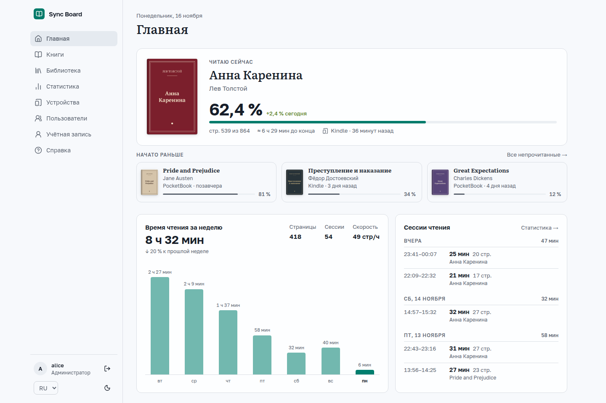

# koreader-sync-board

[](https://github.com/varrcan/koreader-sync-board/actions/workflows/ci.yml)
[](https://github.com/varrcan/koreader-sync-board/releases/latest)
[](https://github.com/varrcan/koreader-sync-board/pkgs/container/koreader-sync-board)
[](server/go.mod)
[](LICENSE)

[English](README.md) | Русский

Лёгкий self-hosted сервер для **стандартного** KOReader: синхронизация прогресса, статистика
чтения и веб-панель — на читалку ничего ставить не нужно.

<picture>
  <source media="(prefers-color-scheme: dark)" srcset="docs/images/panel-ru-dark.png">
  
</picture>

## Возможности

- **Синхронизация прогресса**, совместимая с протоколом KOReader (тот же API, что у
  [koreader-sync-server](https://github.com/koreader/koreader-sync-server)): достаточно указать
  этот сервер во встроенной *Синхронизации прогресса чтения*. Сохраняется каждое обновление,
  в том числе для книг, которых сервер раньше не видел.
- **Одна учётная запись, много устройств**: у каждой читалки свой пароль, который можно отозвать
  отдельно.
- **Статистика чтения** через встроенную облачную синхронизацию KOReader по WebDAV: время,
  страницы и сессии по каждой книге, объединённые со всех читалок.
- **Веб-панель** с книгами в процессе чтения, активностью и статистикой, на русском и
  английском, в светлой и тёмной теме.
- **Библиотека**: каталоги с FB2, EPUB, PDF и другими книгами (только чтение) дают
  синхронизированным книгам названия и обложки; метаданные из FantLab, Open Library и Google
  Books; конвертация FB2 в EPUB; **каталог OPDS** для читалок.
- **Вход через OIDC** (Zitadel, Keycloak, Authentik …) в панель, лимит неудачных входов и логи,
  готовые для fail2ban.
- Один статический бинарник (linux/amd64, linux/arm64) со встроенной SQLite или distroless
  Docker-образ.

## Быстрый старт

```sh
docker run -d --name ksb \
  -v ksb-data:/data \
  -p 8080:8080 \
  ghcr.io/varrcan/koreader-sync-board:latest
docker logs ksb 2>&1 | grep setup_code
```

1. Откройте `http://<хост>:8080`, введите код настройки из лога и создайте администратора.
2. В панели откройте **Устройства** и добавьте устройство для читалки. Его пароль показывается
   один раз.
3. В KOReader: **вкладка инструментов (гаечный ключ) → Синхронизация прогресса чтения → Свой
   сервер синхронизации** → `http://<хост>:8080`, затем **Зарегистрироваться / Войти** с вашим
   именем пользователя и паролем устройства → **Войти**.

Остальное — синхронизацию статистики, OPDS и решение проблем — показывает экран **Справка** в
панели. Чтобы обойтись без Docker, скачайте бинарник из
[Releases](https://github.com/varrcan/koreader-sync-board/releases) (см.
[Установка](docs/ru/installation.md#бинарник)).

## Документация

| | |
|---|---|
| [Установка](docs/ru/installation.md) | Docker, бинарник, systemd, первый запуск |
| [Подключение KOReader](docs/ru/koreader.md) | Синхронизация прогресса, статистика по WebDAV, OPDS |
| [Пользователи и устройства](docs/ru/users.md) | Пароли панели и устройств, командная строка `ksb` |
| [Библиотека и OPDS](docs/ru/library.md) | Каталоги книг, метаданные, FB2 в EPUB, каталог OPDS |
| [Вход через OIDC](docs/ru/oidc.md) | Zitadel, Keycloak, Authentik; роль администратора из claim |
| [Настройка](docs/ru/configuration.md) | Все переменные окружения |
| [Безопасность и обратный прокси](docs/ru/security.md) | Лимит входов, `X-Forwarded-For`, fail2ban |
| [Совместимость с KOReader](docs/koreader-compat.md) | Детали протокола для контрибьюторов (на английском) |

## Разработка

Требования: Go 1.27, Node 22+ с pnpm, [Task](https://taskfile.dev).

```sh
pnpm install
task build                 # веб-панель + bin/ksb со встроенной панелью
task test                  # тесты Go
task lint                  # golangci-lint + eslint
task typecheck             # tsc --noEmit для всех TS-пакетов
task generate              # перегенерировать код Go и TS из api/openapi.yaml
pnpm -F web dev            # dev-сервер панели, проксирует /api на :8080
```

Структура: `server/` (модуль Go), `apps/web` (Vite + React), `packages/api-client`
(генерируется из `api/openapi.yaml`), `packages/i18n` (ru/en). Прежде чем трогать эндпоинты
синхронизации, прочитайте [docs/koreader-compat.md](docs/koreader-compat.md).

## Лицензия

[AGPL-3.0](LICENSE). Конвертация FB2 использует [fb2cng](https://github.com/rupor-github/fb2cng)
(GPL-3.0), подключённый через форк [varrcan/fb2cng](https://github.com/varrcan/fb2cng), который
только добавляет файлы, генерируемые в upstream при сборке.
